<div align="center">
  
  <br/>
  
  <br/><br/>
  <a href="https://github.com/juninmd?tab=repositories"></a>
  <a href="https://linkedin.com/in/jracn"></a>
  <a href="https://medium.com/antoniocarlosjr"></a>
  <a href="https://twitter.com/junin_md"></a>
</div>

---

## 🔥 Em destaque: [tokenix](https://github.com/juninmd/tokenix)

> Entrega ao seu agente de IA só a fatia do código de que ele precisa, não o arquivo inteiro. Índice local em SQLite, grafo de símbolos (tree-sitter), leitura cirúrgica, **filtros determinísticos de saída** (528+) e hooks nativos para Claude Code, Codex, Copilot, Antigravity, OpenCode e qualquer cliente MCP. Escrito em Rust 🦀, sem modelo, sem embeddings e sem daemon.

<div align="center">
  <a href="https://github.com/juninmd/tokenix"></a>
  
  
</div>

## ⚡ Arsenal

<div align="center">
  
</div>

## 🏆 Top repositórios

<!--COUNT:START-->
**281** repositórios públicos
<!--COUNT:END-->

<!--TOP:START-->
| Repo | Linguagem | Stars | Descrição |
|---|---|---|---|
| [**tokenix**](https://github.com/juninmd/tokenix) | Rust | ⭐ 16 | Local code index, tree-sitter symbol graph, deterministic output filters and native agent hooks that trim tokens before they reach the model. |
| [**roadmap-developer**](https://github.com/juninmd/roadmap-developer) | TypeScript | ⭐ 7 | — |
| [**dotfiles**](https://github.com/juninmd/dotfiles) | Shell | ⭐ 5 | Repositório para guardar configurações, padrões, dicas, macetes. |
| [**awesome-tools**](https://github.com/juninmd/awesome-tools) | Python | ⭐ 3 | — |
| [**teresinha**](https://github.com/juninmd/teresinha) | TypeScript | ⭐ 3 | — |
| [**github-assistance**](https://github.com/juninmd/github-assistance) | Python | ⭐ 2 | — |
<!--TOP:END-->

## 🧠 Linguagens (por nº de repos)

<!--LANGS:START-->
```text
(atualizado pelo workflow "Update README")
```
<!--LANGS:END-->

## 🐍 The Guardian

<div align="center">
  
</div>

<div align="center">
  <sub>Seções dinâmicas geradas por <a href="scripts/update-readme.mjs"><code>scripts/update-readme.mjs</code></a> — rode o workflow <i>Update README</i> para renovar.</sub>
</div>
